<div align="center">

# Graded-GaN Compact Model

### An independent, figure-by-figure replication of the compact model for polarization-graded GaN HEMTs<br/>(Nazir *et al.*, *IEEE Trans. Electron Devices* 72(9), 2025), rebuilt in Python and cross-checked in Sentaurus TCAD


-replicated-2ea44f)
-replicated-2ea44f)
-in_progress-orange)

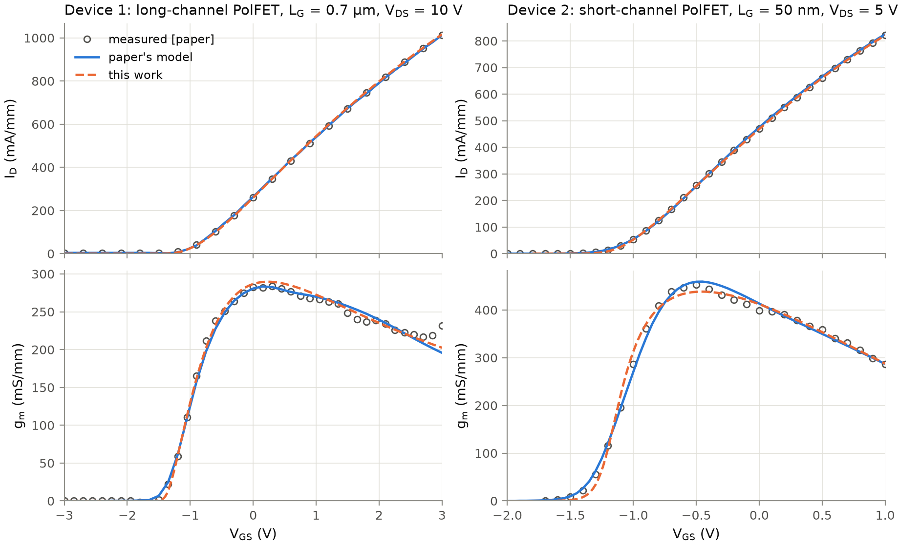

<sub><b>Both devices of the paper, one model.</b> Open circles: measured data; blue: the paper's model (both read from the published figures);
dashed orange: this repository. Per mm of gate width (Device 1: W = 150 µm, Device 2: W = 75 µm).</sub>

</div>

> [!NOTE]
> This is an **independent replication** for an M.Tech thesis (Microelectronics & VLSI, IIT Bhilai). It is not affiliated with the
> original authors. The model, its physics and the measured data belong to Nazir, Shayoub, Venkatesan, Fay and Chauhan
> ([doi:10.1109/TED.2025.3592176](https://doi.org/10.1109/TED.2025.3592176)); the long-channel measurements are from
> Sohel *et al.*, *IEEE EDL* 41(1), 2020. Everything plotted from the paper was read from the vector graphics of its PDF and is shown
> for comparison only.

---

## Contents

- [Why this project](#why-this-project)
- [Results at a glance](#results-at-a-glance)
- [How it works](#how-it-works)
- [The model in four equations](#the-model-in-four-equations)
- [Results](#results)
- [TCAD cross-checks](#tcad-cross-checks)
- [Replication status](#replication-status)
- [Printed items we could not use as printed](#printed-items-we-could-not-use-as-printed)
- [Where we deviate, and why](#where-we-deviate-and-why)
- [Quick start](#quick-start)
- [Repository layout](#repository-layout)
- [Roadmap](#roadmap)
- [Citing](#citing)

---

## Why this project

GaN HEMTs are the workhorse of RF power amplifiers, but their transconductance $g_m$ drops soon after its peak, which limits
linearity. Grading the aluminium content of the barrier spreads the polarization charge over a volume, the electrons form a
three-dimensional slab instead of a sheet, and $g_m$ becomes **flatter**. Circuit design needs a compact model of that behaviour;
Nazir *et al.* published a physics-based one in 2025 and validated it from DC to 110 GHz on two devices.

The paper prints the equations but no parameter values. This repository rebuilds every equation, reproduces the figures one by one,
and records each place where the printed text was not enough, with the evidence.

## Results at a glance

| | This work | The paper's model<br/><sub>(same points)</sub> |
|---|:---:|:---:|
| **Device 1** (0.7 µm gate) — transfer $I_D$, rms over 15 points | **0.48 mA** | 0.51 mA |
| **Device 1** — $g_m$, rms over 29 points | **0.90 mS** | 0.96 mS |
| **Device 1** — output curves, rms over 180 points | **1.04 mA** | 1.28 mA <sub>(171 points)</sub> |
| **Device 2** (50 nm gate) — transfer $I_D$, rms over 25 points | **0.18 mA** | 0.25 mA |
| **Device 2** — $g_m$, rms over 25 points | **0.86 mS** | 0.76 mS |

<sub>Not a claim of a better model: our parameters were fitted to these very points, and the paper's curves were read from its figures.
The point is that the rebuilt model reaches the published accuracy.</sub>

**Findings along the way**

- 🔎 **13 printed items** that cannot be used as printed, each checked against the paper's own figures or a re-derivation ([list](#printed-items-we-could-not-use-as-printed)).
- 🧮 With the constants inferable from the paper, the **closed-form charge has no real root** over part of the bias range of both devices; we solve the paper's charge equations numerically and keep its subthreshold parameter $\gamma$.
- ⚖️ The terminal charges are exact and conserve charge, but **$C_{gs} \neq C_{gd}$ at $V_{DS}=0$**: the limit is $1/(2a-1)$, not 1 (source–drain symmetry test).
- 🧪 TCAD: on a relaxed AlGaN buffer, the **default strain reference changes the sheet density under the gate by 26 %**; and the TCAD charge supports $C_g'' = \varepsilon/(d+t)$ rather than the printed $\varepsilon/(2d+t)$.

## How it works

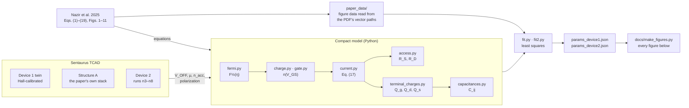

Three rules hold throughout:

1. **Provenance.** Every number carries a source label (see [labels](#source-labels)); nothing is invented.
2. **Printed and corrected side by side.** Each equation is coded as printed and, where needed, as corrected, and the paper's own figure decides.
3. **Own inputs.** Where the model needs a device input the paper does not print, it comes from our own TCAD, not from tuning to the target curve.

## The model in four equations

The channel charge $n$ follows from the electron statistics and the gate charge balance, solved together:

$$
n=\left[N_C\,\mathcal{F}_{1/2}(\eta_F)\right]^{2/3},\qquad q\,n=C_g''\left(V_{g0}-m\,\phi_t\,\eta_F\right),\qquad V_{g0}=V_{GS}-V_{OFF},\quad m=\frac{2}{3\gamma}
$$

The drain current, Eq. (17) of the paper, with a charge-dependent saturation velocity and a smooth transition into saturation:

$$
I_{DS}=\frac{W}{L}\,\mu_{eff}\,C_g''\left(V_{g0}-V_m+\phi_t\right)V_{DS,eff},\qquad
V_{SAT}(n)=\frac{V_{SAT0}}{\theta_{SAT1}+\left(n/n_{max}\right)^{\theta_{SAT2}}},\qquad
V_{DS,eff}=\frac{V_{DS}}{\left[1+\left(V_{DS}/V_{DSAT}\right)^{\delta}\right]^{1/\delta}}
$$

Access resistances that rise with current set the external bias, and the terminal charges $Q_g, Q_d, Q_s$ follow from the
Ward–Dutton partition of the same channel charge.

<details>
<summary><b>Symbols</b></summary>

| Symbol | Meaning |
|---|---|
| $n$ | electron sheet density (cm⁻²) |
| $\eta_F$ | Fermi level in units of the thermal voltage $\phi_t$ |
| $N_C$, $\mathcal{F}_{1/2}$ | effective density of states; Fermi–Dirac integral of order ½ (Eq. (2), with the factor $2/\sqrt{\pi}$) |
| $C_g''$ | gate capacitance per unit area |
| $V_{OFF}$ | turn-off voltage, Eq. (8) |
| $\gamma$ | subthreshold parameter of Eq. (9); $m = 2/(3\gamma)$ carries it into the numerical solution ($\gamma = 2/3$ gives $m = 1$) |
| $V_m$ | average channel potential |
| $\theta_{SAT1}, \theta_{SAT2}, n_{max}$ | constants of the charge-dependent saturation velocity |
| $\delta$ | smoothing exponent of $V_{DS,eff}$ |

</details>

## Results

### Device 1 — long-channel graded FET, DC

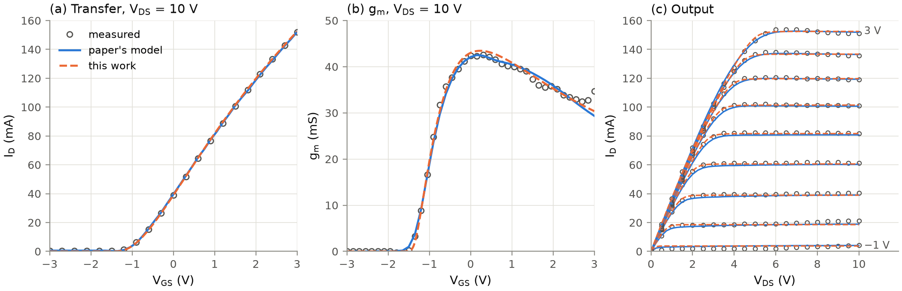

Five parameters fitted [CALIBRATE]; everything else fixed from the paper, the cited Hall data or our TCAD.

| Fitted | Value | | Fixed | Value | Source |
|---|---|---|---|---|---|
| $U_0$ (access mobility) | 631 cm²/V·s | | $V_{OFF}$ | −1.26 V | Eq. (8) with TCAD polarization |
| $V_{SAT0}$ | 7.47×10⁴ m/s | | low-field mobility | 910 cm²/V·s | Hall, Sohel *et al.* |
| $\theta_{SAT2}$ | 0.564 | | $\theta_{SAT1}$, $n_{max}$ | 0.3, 5×10¹² cm⁻² | the paper's Fig. 7(c) |
| $\delta$ | 4.35 | | access density | 1.13×10¹³ cm⁻² | our TCAD |
| $\beta$ (access) | 1.29 | | $R_{S0}$ / $R_{D0}$ | 0.44 / 3.06 Ω·mm | result |

### Device 2 — short-channel graded HEMT, DC

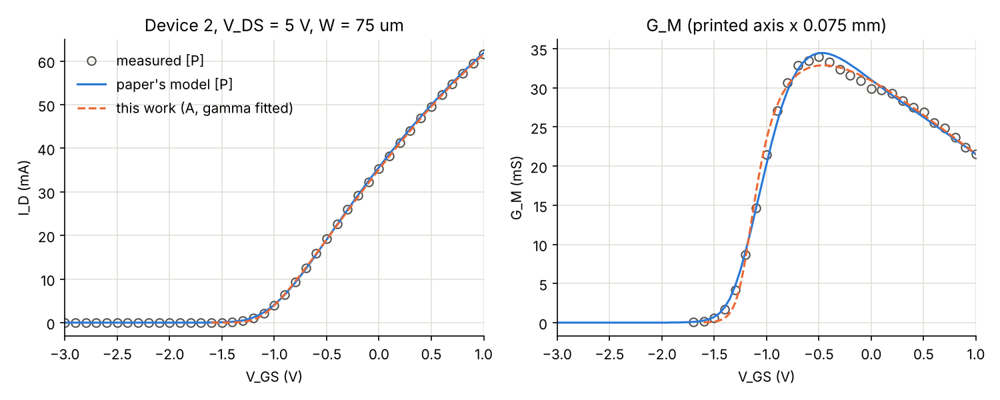

| Fitted | Value | | Fixed | Value | Source |
|---|---|---|---|---|---|
| $\gamma$ | 0.399 (149 mV/dec) | | $V_{OFF}$ | −1.01 V | TCAD charge (−0.63 V) + TCAD drain-bias shift (−0.38 V) |
| $U_0$ | 886 cm²/V·s | | $C_g''$ | $\varepsilon/(2d+t)$ | printed form, kept for fidelity |
| $V_{SAT0}$ | 9.74×10⁴ m/s | | low-field mobility | 1380 cm²/V·s | our TCAD |
| $\theta_{SAT2}$ | 0.957 | | access density | 3.6×10¹² cm⁻² | our TCAD |
| $\beta$, $\delta$ | 18.4, 3.4–5.4 | | $L_{SG}$, $L_{GD}$ | 0.6 µm | the paper's Fig. 5(b) |

> [!TIP]
> With $V_{OFF}$ left free, the fit lands at −1.06 V, 50 mV from the TCAD value, which is a useful independent check of the
> TCAD route. $\gamma$ is an effective value at $V_{DS}$ = 5 V: the model has no drain-induced barrier lowering, so $\gamma$ absorbs it.
> $\delta$ is weakly set by data at $V_{DS}$ = 5 V (deep saturation): different starts and machines give 3.4 to 5.4 with the same rms.

### The charge model against the paper's Fig. 4

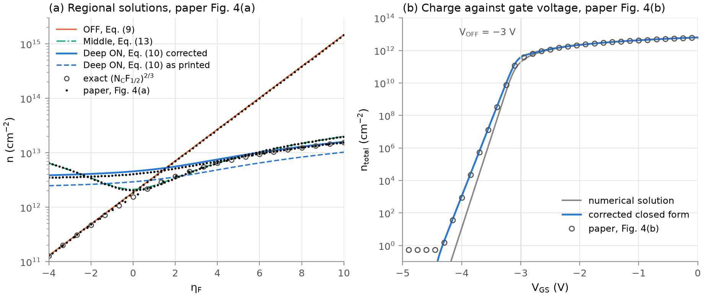

Equation (10) as printed is 34 % low at $\eta_F = 10$; with its prefactor raised to the 2/3 power it is within 3 % and follows the
published curve. The numerical solution matches the paper's Fig. 4(b) within **1.8 % rms** (17 points, −2.5 to 0 V).

### Closed form against the numerical solution

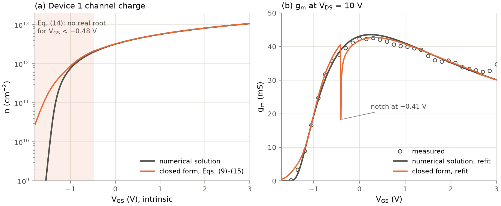

With the constants we could infer, the middle-region root of Eq. (14) is not real below −0.48 V on Device 1 (and from −2.0 to −0.07 V
on Device 2). The closed form then leaves a notch in $g_m$ that the measurement and the paper's own curve do not have. We therefore
solve the paper's two charge equations numerically on a 10 mV grid, joined by a quintic spline, which is the reference curve the paper
itself plots in Fig. 4(a).

### Terminal charges and capacitances

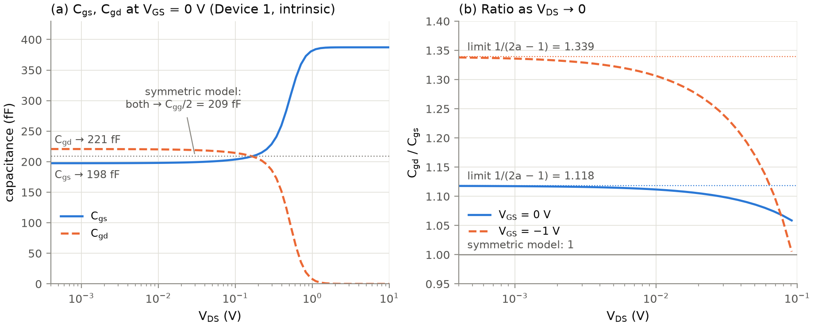

<details>
<summary><b>Consistency checks (all pass)</b></summary>

| Check | Result |
|---|---|
| $Q_g$, $Q_d$ against their channel integrals | identical in SymPy; 10⁻¹⁵ numerically |
| Charge conservation: columns of the capacitance matrix sum to zero | within 2×10⁻¹³ of the largest entry |
| Reference independence: rows sum to zero | within 8×10⁻¹³ |
| $V_{DS} = 0$: drain and source share the channel charge | half each |
| Pinch-off, $\phi_t \to 0$: drain-to-source split | 40/60, the Ward–Dutton value |
| $C_{gg}$ at $V_{DS} = 0$ against $q W L\, dn/dV_{GS}$ | within 2×10⁻¹⁰ |
| Source–drain symmetry (McAndrew 2006): $C_{gd}/C_{gs}$ as $V_{DS} \to 0$ | **1.118** at $V_{GS}$ = 0 V, 1.339 at −1 V (symmetric model: 1) |

The asymmetry comes from the drain-end charge following the drain with slope 1 while the source-end charge follows the gate with
slope $a < 1$, giving the limit $1/(2a-1)$. In saturation the intrinsic $C_{gd}$ is below 10⁻⁴ fF because Eq. (17) has no
channel-length modulation, so the paper's RF results must rest on fringing capacitances, which it mentions but does not specify.

</details>

## TCAD cross-checks

All TCAD is Sentaurus Device T-2022.03-SP2, with the decks in [`tcad_scripts/`](tcad_scripts/), one change per run.

### Device 2: TCAD against the measurement

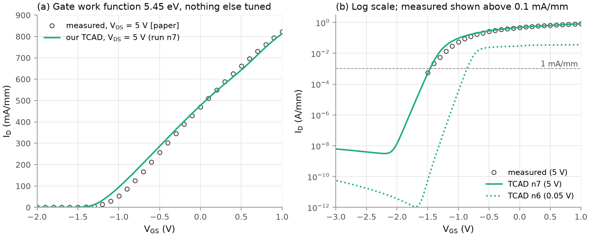

Only the gate work function (5.45 eV, carried over from the paper's own simulated stack) sets the turn-off. At $V_{DS}$ = 5 V the TCAD
current reaches 1 mA/mm at −1.464 V against −1.457 V measured, and is within 1.4 % at $V_{GS}$ = 0 (477 against 471 mA/mm).

### Device 2: the strain reference matters

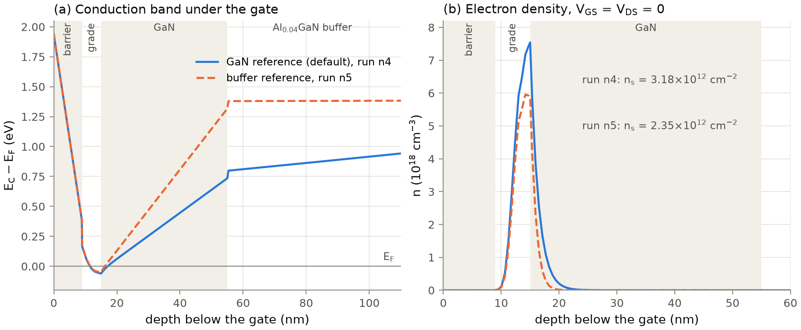

Sentaurus strains every layer to the GaN lattice by default. Device 2 is grown on a relaxed Al₀.₀₄Ga₀.₉₆N buffer, so the layers above
are strained to the buffer (a₀ = 3.1859 Å by Vegard's law). Setting it explicitly adds −0.93×10¹² cm⁻² at the buffer/channel junction
(predicted: −0.92×10¹²), raises the back barrier from 0.73 to 1.32 eV and lowers the sheet density under the gate by 26 %.

### Device 2: which gate capacitance?

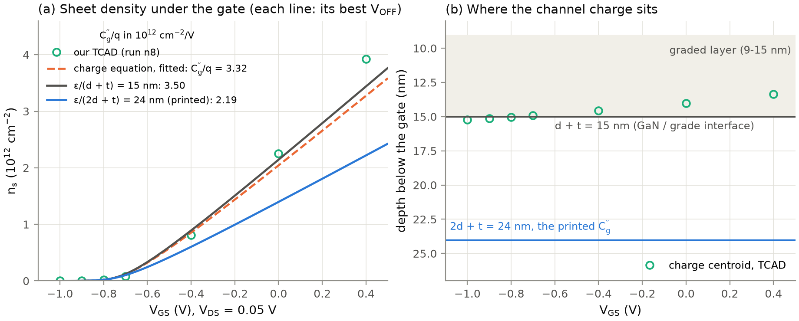

The electrons sit at the GaN/grade interface, 15 nm below the gate, exactly where the paper's sheet model puts them, and move up into
the grade as $n_s$ grows. A free fit of the paper's charge equation gives $C_g''/q$ = 3.32×10¹² cm⁻²/V, within 5 % of
$\varepsilon/(d+t)$ and far from the printed $\varepsilon/(2d+t)$ (2.19×10¹²). A Gauss-law re-derivation gives the same answer.
The model keeps the printed form for fidelity; this is printed item 13.

<details>
<summary><b>Device 1 and Structure A</b></summary>

| Quantity | Our TCAD | Reference |
|---|---|---|
| Device 1 · access sheet density | 1.13×10¹³ cm⁻² | 1.1×10¹³ cm⁻², Hall (Sohel *et al.*) |
| Device 1 · mobility | 888 cm²/V·s | 910 cm²/V·s, Hall |
| Device 1 · $I_D$ from −0.9 to 0.6 V | within 4 % | measured transfer curve |
| Device 1 · polarization across the grade | 3.41 µC/cm² | 3.16 µC/cm² from Eq. (3) |
| Structure A · surface barrier | 1.94 eV | 1.94 eV, the paper's Fig. 1(a) |
| Structure A · peak electron density | 9.8×10¹⁸ cm⁻³ | 9.1×10¹⁸ cm⁻³, Fig. 1(a) |
| Structure A · sheet density | 3.39×10¹² cm⁻² | 4.4×10¹² cm⁻², Fig. 1(a): **23 % low, open** |

</details>

## Replication status

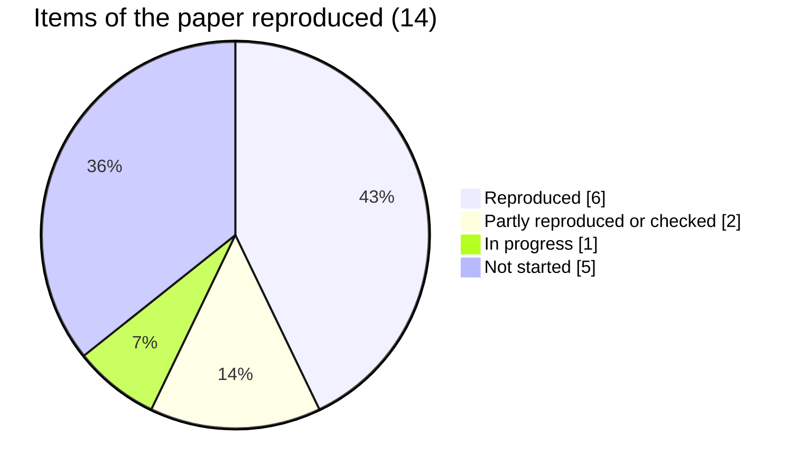

| Paper item | What it shows | Status | Result |
|---|---|:---:|---|
| Fig. 1(b) | Fermi–Dirac approximation | ✅ | within 0.8 % (with $2/\sqrt{\pi}$) |
| Fig. 4(a) | regional charge solutions | ✅ | corrected Eq. (10) within 3 % |
| Fig. 4(b) | charge against gate voltage | ✅ | 1.8 % rms |
| Fig. 6(a) | Device 1 transfer and $g_m$ | ✅ | 0.48 mA, 0.90 mS rms |
| Fig. 7(a) | Device 1 output | ✅ | 1.04 mA rms |
| Fig. 6(b) | Device 2 transfer and $g_m$ | ✅ | 0.18 mA, 0.86 mS rms |
| Figs. 1(a), 2 | TCAD of the paper's stack (Structure A) | 🟡 | band edge and peak density match; $n_s$ 23 % low |
| Fig. 7(b) | Device 2 output | 🟡 | checked, not fitted: 3.8 mA rms (curve labels not printed) |
| Fig. 6(c) | Device 2 $g_m$, $g_{m2}$, $g_{m3}$ | 🔵 | data extracted |
| Fig. 7(c) | saturation-velocity study | ⬜ | |
| Fig. 8 | Device 2 S-parameters | ⬜ | |
| Fig. 9 | Device 2 $S_{21}$ and extracted $g_m$ | ⬜ | |
| Fig. 10 | Device 1 large-signal and two-tone at 10 GHz | ⬜ | |
| Fig. 11 | Device 1 $H_{21}$, $U$, $f_T$, $f_{MAX}$ | ⬜ | |

<sub>✅ reproduced · 🟡 partly reproduced or checked · 🔵 in progress · ⬜ not started. Figs. 3 and 5 are schematics.</sub>

## Printed items we could not use as printed

Each item was checked against the paper's own figures or by re-derivation. The first author's PhD thesis prints items 1, 3, 4, 5 and
6 in the same form. **The list has not yet been confirmed by the original authors.**

<details>
<summary><b>Show all 13 items</b></summary>

| # | Item | As printed | Evidence | Form used here |
|---|---|---|---|---|
| 1 | Eq. (2) | no factor $2/\sqrt{\pi}$ | Fig. 1(b) agrees within 0.8 % only with the factor (13 % without) | factor restored |
| 2 | Eqs. (3)–(6) | polarization in C·cm⁻² | gives $V_{Total}$ = 6563 V; 0.656 V in SI units | SI units |
| 3 | Eq. (8) | signs of the $n_{ch}$ and $V_{OFF}$ terms | gives $V_{OFF}$ = +7.26 V for a normally-on device | sign-consistent form |
| 4 | Eqs. (10)–(11) | prefactor not raised to 2/3 | 34 % low at $\eta_F$ = 10; 3 % high when raised | prefactor$^{2/3}$ |
| 5 | Eq. (14) | $P_2^2 - 4P_1P_2$ under the root; $2P_3$ below | negative at every bias | re-derived root |
| 6 | Eq. (15) | $(n_{sm} - n_{on})$ before the root | never positive; the text defines the minimum | $(n_{sm} + n_{on})$ |
| 7 | Eq. (16) | $-q\,n_{ch}$ | integrates to Eq. (17) only with $+q\,n_{ch}$ | Eq. (17) |
| 8 | $V_{DSAT}$ | built on $V_{g0}$ | $I_D$ = −261 mA at $V_{GS}$ = −3 V, $V_{DS}$ = 10 V | $q\,n/C_g''$ in place of $V_{g0}$ |
| 9 | text under Eq. (18) | substitution divides by $V_{DS}$ | the channel would end at 0.057 L for $V_{DS}$ = 10 V | $V_{ch,d} - V_{ch,s}$ |
| 10 | Sec. III | $L_G$ = 700 µm | 0.7 µm in the same paragraph | 0.7 µm |
| 11 | Figs. 6(b), 6(c) | $g_m$ axes in mS and S | printed $g_m$ / slope of printed $I_D$ = 13.3 = 1/0.075 mm at every bias | per mm |
| 12 | Fig. 7(b) | 14 curves, "−3 V to 1 V", no step | top curve 52 mA against 61.7 mA in Fig. 6(b) at the same bias | labels inferred from Fig. 6(b) |
| 13 | below Eq. (8) | $C_g'' = \varepsilon/(2d+t)$; barrier term $\sigma d/\varepsilon$ | Gauss's law and our TCAD give $\varepsilon/(d+t)$; the grade charge also acts across the barrier | printed form kept; physics noted |

</details>

## Where we deviate, and why

<details>
<summary><b>Deviation audit</b> (each one documented in the code with a <code>[DEVIATION]</code> label)</summary>

| # | Deviation | Why | Effect |
|---|---|---|---|
| D1 | Channel charge from the numerical solution of the paper's charge equations, not the closed form (Eqs. (9)–(15)); $\gamma$ of Eq. (9) enters as $m = 2/(3\gamma)$ | the closed form has no real middle-region root over much of the bias range with the inferable constants; the paper plots the numerical solution as its own reference | removes the $g_m$ notch; with $\gamma$ the turn-on matches the paper's level |
| D2 | $V_{DSAT}$ uses $\mu$ without the $\theta_{sat}$ factor | keeps $V_{DSAT}$ closed-form | none: $\theta_{sat}$ = 0 |
| D3 | $n_{total}$ clamped at 1 cm⁻² | Eq. (15) turns negative deep in the off-state | none in any fitted range |
| D4 | Device 2 $V_{OFF}$ from TCAD (charge + drain-bias shift) | Eq. (8) gives +0.12 V even sign-corrected; the paper prints no value | best-fit $V_{OFF}$ lands 50 mV away |

Not deviations, but limits on "same to same": the paper prints none of $m^*$, $\varepsilon_r$, $\theta_1$, $\theta_2$, $\gamma$ or the fitted
values, so these come from its figures or from our fits, each labelled.

</details>

<a id="source-labels"></a>
<details>
<summary><b>Source labels used in the code and the records</b></summary>

| Label | Meaning |
|---|---|
| `[P]` | the paper |
| `[R#]` | a reference cited by the paper |
| `[T]` | the first author's PhD thesis |
| `[TCAD]` | our Sentaurus runs |
| `[CALC]` | derived by us |
| `[CALIBRATE]` | fitted by us |
| `[ASSUME]` | assumed, with the reason given |
| `[DEVIATION]` | differs from the paper, with the reason given |

</details>

## Quick start

```bash
python3 -m venv .venv && source .venv/bin/activate
pip install -r requirements-lock.txt

python3 fit.py                       # Device 1 fit  -> params_device1.json   rms 0.48 mA / 1.04 mA / 0.90 mS  (seconds)
GAN_DEVICE=2 python3 fit2.py         # Device 2 fit  -> params_device2.json   rms 0.18 mA / 0.86 mS            (1-2 min)
GAN_DEVICE=2 python3 plot_fig6b.py   # Device 2 figure -> fig6b_device2.png
python3 docs/make_figures.py         # every figure in this README -> docs/figures/   (about 10 s)
```

`device.py` selects the device at import (`GAN_DEVICE=2` for Device 2, Device 1 otherwise), so every earlier script runs unchanged.
The step notebooks (`step1c_fig1b.ipynb` … `step5c_device1_final.ipynb`) walk through the build in order.

## Repository layout

```text
graded-gan-compact-model/
├── fermi.py              Fermi–Dirac integral: exact and Eq. (2)
├── charge.py             regional charge solutions, Eqs. (9)–(13)
├── gate.py               channel charge n(V_GS): numerical solution and closed form, Eqs. (8)–(15)
├── current.py            drain current, Eq. (17)
├── access.py             current-dependent access resistances; external current
├── terminal_charges.py   Q_g, Q_d, Q_s (Ward–Dutton), Eqs. (18)–(19)
├── capacitances.py       capacitance matrix and its checks
├── device.py             picks Device 1 or Device 2 (GAN_DEVICE)
├── device1.py, device2.py    device geometry and inputs, every value labelled
├── fit.py, fit2.py       least-squares fits -> params_device1.json, params_device2.json
├── fit2_checkB.py        Device 2 check with V_OFF also fitted
├── plot_fig6b.py         Device 2 figure
├── paper_data/           data read from the paper's figures (CSV, provenance in each header)
├── docs/                 README figures, the script that makes them, and the small TCAD data they use
├── tcad_scripts/         Sentaurus decks (Device 2 runs in tcad_scripts/device2/)
├── tcad_data/            exported TCAD data used by the notebooks
├── step*.ipynb           step-by-step notebooks
└── requirements-lock.txt exact package versions
```

## Roadmap

- [x] Fermi–Dirac integral and charge model; Figs. 1(b), 4(a), 4(b)
- [x] Device 1 DC fit; Figs. 6(a), 7(a)
- [x] Terminal charges and capacitances, Eqs. (18)–(19), with symmetry and conservation checks
- [x] Device 2 TCAD: strain reference, work function, gate sweeps, charge snapshots (runs n5–n8)
- [x] Device 2 DC fit with $\gamma$; Fig. 6(b)
- [ ] Device 2 higher-order transconductance; Fig. 6(c)
- [ ] Linearity figures of merit: gate voltage swing, $V_{IP3}$, intrinsic $f_T$
- [ ] Saturation-velocity study; Fig. 7(c)
- [ ] Verilog-A port for Spectre and ADS
- [ ] RF validation; Figs. 8–11
- [ ] Gate-length validity study in TCAD (50 nm to 0.7 µm)
- [ ] Send the list of printed items to the original authors

## Citing

The model is the work of Nazir *et al.*; please cite the original paper:

```bibtex
@article{nazir2025graded,
  author  = {Nazir, M. S. and Shayoub, M. M. and Venkatesan, N. and Fay, P. and Chauhan, Y. S.},
  title   = {A Compact Model for Polarization-Graded {HEMTs} Demonstrating Enhanced Linearity},
  journal = {IEEE Transactions on Electron Devices},
  volume  = {72},
  number  = {9},
  pages   = {4795--4801},
  year    = {2025},
  doi     = {10.1109/TED.2025.3592176}
}
```

## Acknowledgments

M.Tech thesis, Microelectronics & VLSI, IIT Bhilai, by **Mayank Ratnakar**, supervised by Dr. Nikhil Chander and Dr. Nitanshu Chauhan.
Thanks to the authors of the original paper for publishing the model and the measured data this work builds on. Code, figures and
text were prepared with the assistance of an AI system (Claude, Anthropic); every result was re-run and checked by the author.

<sub>No license has been chosen yet, so all rights are reserved for now.</sub>

<div align="right"><a href="#graded-gan-compact-model">back to top ↑</a></div>
